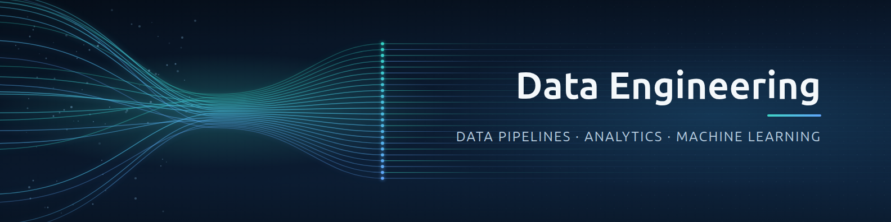

# Dennis Kasper

Data engineer and full-stack developer based in Saarland, Germany. I build data platforms that turn scattered, inconsistent raw data into a reliable basis for analysis and decisions, from the data pipeline and the data model to the application business users work with. Since 2012 I have been working where data engineering, business intelligence and software development meet.

My focus is data engineering: ETL and ELT pipelines in Python and SQL, dimensional data models and automated quality checks that keep analyses reproducible. On top of that I build analytics applications across the full stack, with Python API backends and React front ends, and extend them with time series forecasting based on machine learning.

Technology follows the business goal: I clarify requirements directly with business teams and carry them through to production myself.

## Tech stack

- **Data:** Python (Polars, pandas, SQLAlchemy), SQL (PostgreSQL, MySQL, DuckDB)
- **Machine learning:** scikit-learn, LightGBM, Keras
- **Applications:** FastAPI, React, TypeScript
- **Operations and tooling:** Docker, Kubernetes, Git, Linux

## Projects

**[grid-load-forecast](https://github.com/deka641/grid-load-forecast)**: day-ahead forecast of the German grid load from public SMARD data. A Polars and DuckDB pipeline loads and validates the source data, a LightGBM model forecasts every hour of the next delivery day, and a FastAPI backend serves the results to a React and TypeScript dashboard. In a one-year backtest the model reaches a MAPE of 3.04 %, against 3.92 % for the grid load forecast SMARD publishes. The whole stack starts with Docker Compose.

## Contact

[LinkedIn](https://www.linkedin.com/in/dennis-kasper/)
